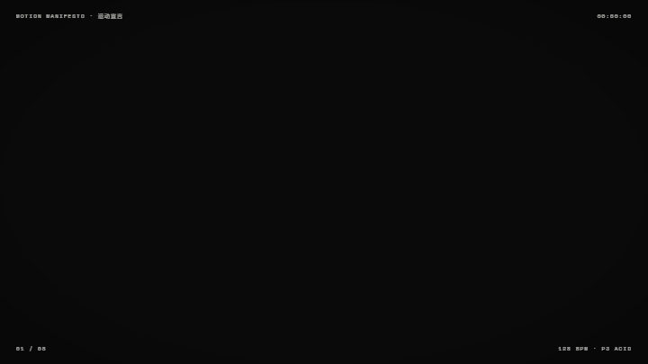
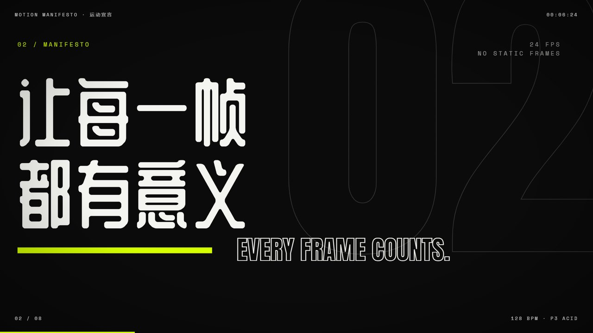
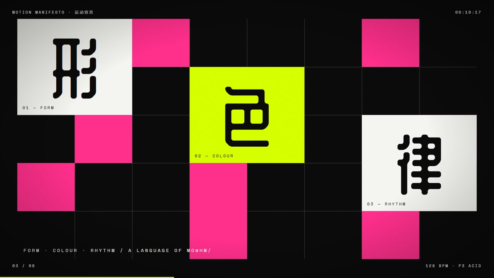
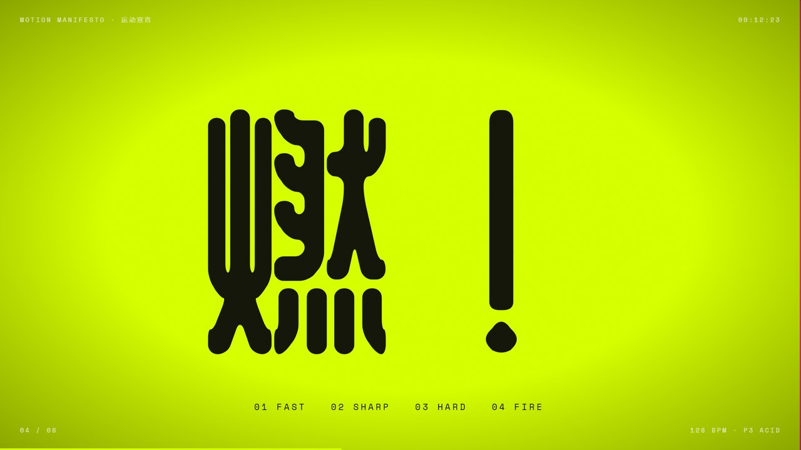
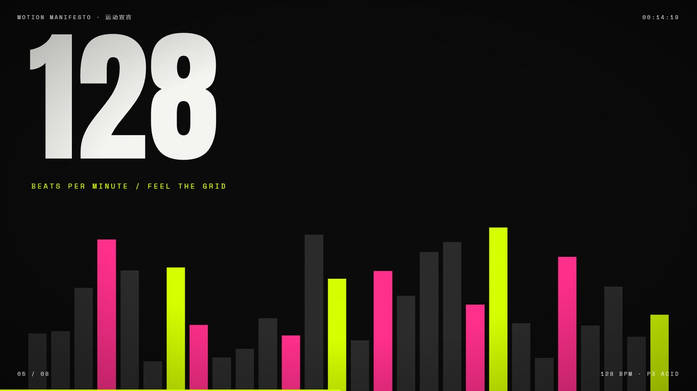
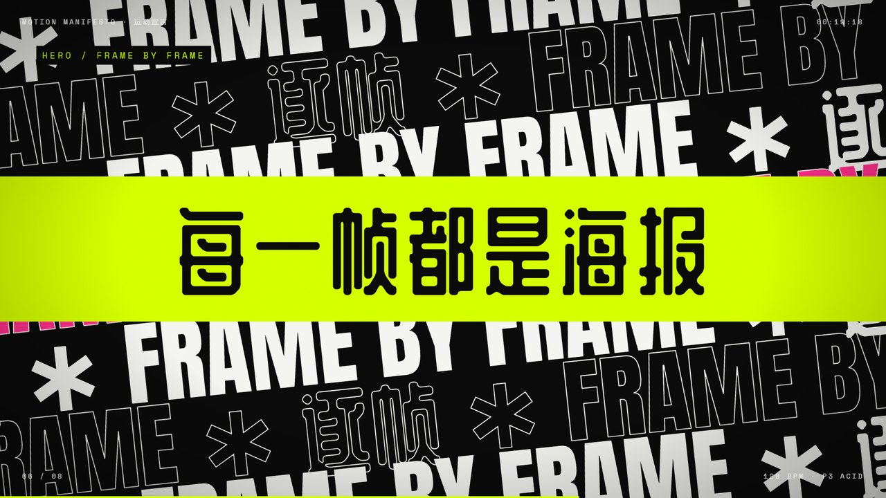
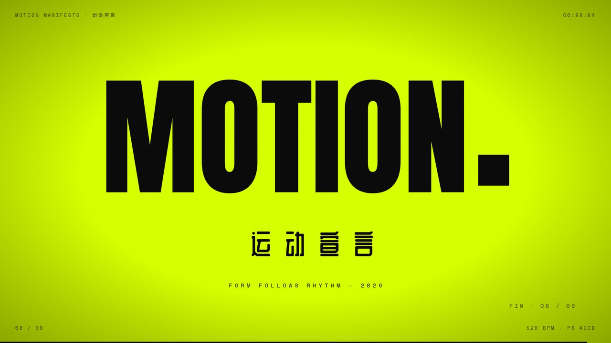
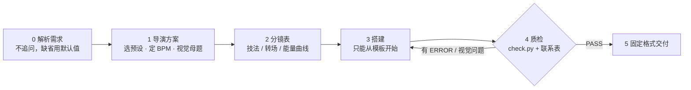
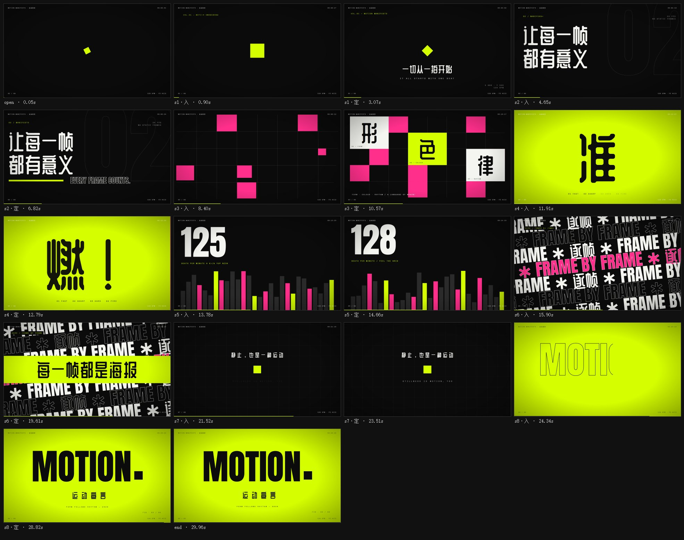

<div align="center">

# 🎬 cinematic-motion

**让 AI 稳定做出「专业运动设计师水准」的电影级动态图形 —— 一个 Claude Skill**

大胆排版 · 几何形状 · 卡点节奏 · 动态转场 · 电影质感<br>
输出单文件 HTML，浏览器即播，可逐帧导出 MP4

<a href="https://liveliho.github.io/cinematic-motion-skill/examples/motion-manifesto.html"></a>

**▶ [在线播放样片](https://liveliho.github.io/cinematic-motion-skill/examples/motion-manifesto.html)** &nbsp;·&nbsp; [下载 MP4（1080p · 12.8 MB）](https://github.com/liveliho/cinematic-motion-skill/releases/download/v1.0.0/motion-manifesto.mp4) &nbsp;·&nbsp; [HTML 源文件](examples/motion-manifesto.html) &nbsp;·&nbsp; [下载 skill 包](https://github.com/liveliho/cinematic-motion-skill/releases/latest)

<sub>上面的 GIF 是精华剪辑（已去掉胶片颗粒以压缩体积）；完整版请在线播放（空格暂停，← → 拖动），或下载 MP4。</sub>

</div>

---

## 为什么需要它

以前让 AI 做动态图形，提示词往往是这样的：

> 创建看起来像电影的动态图形。专业。……使结果大胆、动态……让结果看起来专业而大胆。最大化你的创造力。

全是形容词。AI 每次都在盲猜时长、画幅、风格、节奏、技术方案，质量忽高忽低。**cinematic-motion 把专业动效设计师的工作方式写成了 AI 能照做、也能被检查的规则：**

| 以前（盲目） | 现在（skill） |
|---|---|
| 一句形容词堆砌的提示词 | **6 步固定工作流**，每步有通过条件，质检不过不交付 |
| AI 随意选库（GSAP / CSS 动画 / Canvas…） | **统一的内置时间轴引擎 REEL**：零依赖、确定性、可逐帧定位 |
| 风格靠运气 | **7 个完整风格预设**：色板 hex、字体、BPM、运动性格、禁忌 |
| “各种视觉技巧”说了等于没说 | **26 个技法 + 16 种转场**，每个都附可直接使用的代码 |
| 节奏随缘 | **BPM 拍点网格**、结构模板、能量曲线、缓动与时长表 |
| 做完就交 | **自动质检脚本 + 联系表截帧 + 视觉自检清单** |
| 只能在网页里看 | **一条命令导出 MP4** |

## 样片剧照

> 需求只有一句「创建看起来像电影的动态图形，大胆、专业、最大化创造力」。skill 自拟了概念「运动宣言」：**一个酸绿色方块就是全片的节拍器**——它随拍跳动、冲向镜头盖满画面、在呼吸场缩成一个点，最后扩张成整个画面，化作签名 `MOTION.` 的句点。风格 P3 酸性野兽派 · 128 BPM · 30 秒 · 8 场。

| | | |
|:---:|:---:|:---:|
|  |  |  |
| **s2** · T01 遮罩升起 | **s3** · T12 网格生成 | **s4** · T07 一拍一词 |
|  |  |  |
| **s5** · T13 律动条 + 数字滚动 | **s6** · T06 文字墙（英雄时刻） | **s8** · T05 描边填充（签名） |

## 工作流

AI 读到这个 skill 后，会严格按以下 6 步执行，不做范围外的事：



**范围护栏**：只产出「按时间轴自动播放的动画 HTML」；不做网页 / 幻灯片 / 交互应用；不引入外部动画库；禁用 `@keyframes`、`transition`、`setTimeout`、`Math.random` 等会脱离时间轴的写法——`check.py` 会逐条拦截。

## 快速开始

### 1. 安装

**Claude Code**（终端或桌面版 Code 标签页）——克隆后把 skill 文件夹复制到个人 skills 目录：

```bash
git clone https://github.com/liveliho/cinematic-motion-skill.git
```

```bash
cp -r cinematic-motion-skill/cinematic-motion ~/.claude/skills/
```

只想在某个项目里用，就复制到那个项目的 `.claude/skills/` 下。

**Claude.ai / Claude 桌面版聊天**：在 [Releases](https://github.com/liveliho/cinematic-motion-skill/releases/latest) 下载 `cinematic-motion.skill`，到「设置 → 功能 → Skills」上传。

**导出 MP4（可选）**：

```bash
pip install playwright imageio-ffmpeg
```

脚本直接调用系统里的 Edge 或 Chrome，不需要另外下载浏览器。

### 2. 使用

装好后正常描述需求即可，skill 会自动触发：

```text
做一支 30 秒的电影感片头，主题是「2026 设计周」，要有冲击力。
```

```text
把这句文案做成动态图形：「慢一点，才能看清世界。」风格高级、安静。
```

```text
给 AI 产品 Nova 做一个 20 秒的发布会开场，品牌色 #6C5CE7。
```

```text
做一个抖音竖版的中秋动态海报，新中式风格。
```

想更精确，可以直接点名预设和参数：`P1 黑色片头，45 秒，片名《无声之城》` · `P2 瑞士风格，120 BPM，15 秒，三个数字：98% / 3x / 24h`。

### 3. 观看与导出

浏览器打开生成的 HTML 即自动循环播放：

| 操作 | 按键 |
|---|---|
| 播放 / 暂停 | `空格` 或点击画面 |
| 跳 1 秒 / 1 小节 | `←` `→` / `Shift` + `←` `→` |
| 从头播放 | `0` |
| 隐藏控制条 | `H` |
| 定格到某一秒 | 网址后加 `?t=12.5` |

```bash
python cinematic-motion/scripts/render.py 你的影片.html
```

输出同名 `.mp4`（H.264 · 1080p · 30fps）。画面是确定性的，导出结果与浏览器播放逐帧一致；30 秒样片约 30 秒渲染完。

## 提示词：从“形容词”到“标准”

**原提示词的问题**：

1. 「专业」「大胆」各出现两次，但都是形容词，没有可执行的标准。
2. 没有交付物定义：时长、画幅、格式、能否循环，全靠 AI 猜。
3. 没有主题和文案，AI 只能编，内容常常空洞。
4. 「各种视觉技巧」「动态过渡」没有下限，AI 可能用两三种淡入淡出就交差。
5. 没有节奏标准——而节奏恰恰是专业与业余的最大分水岭。
6. 没有验收方式，好不好看没人检查。

### 装了 skill 后，只需要这样说

```text
做一支 {时长} 秒的动态图形，主题「{主题 / 文案}」，{风格}风格。
```

主题都可以不给，例如「做一支很酷的电影感动态图形」——skill 会自拟概念、补全其余标准。

### 不装 skill 也能用的完整版

```text
你是一位顶级运动设计师兼导演。请制作一支电影级动态图形短片。

【交付】单个 HTML 文件，浏览器打开即自动循环播放；{30} 秒；{16:9，1920×1080}。
【主题 / 文案】{你的主题、品牌或文案；没有就写“自拟一个有张力的概念主题”}
【风格】{黑色电影片头 / 瑞士国际主义 / 酸性野兽派 / 科技 HUD / 杂志奢华 / 波普 / 新中式，选一个}

【质量标准】像顶级片头工作室的作品——每一帧单独截出来都是一张海报，连起来有呼吸、有重拍、有惊喜。
1. 排版是主角：英雄字占画面宽度 60–90%，极端字重对比；文字被遮罩、切割、描边、放大穿越。
2. 形状有目的：线、圆、网格用来揭示文字、承接转场，并贯穿成全片的视觉母题。
3. 卡点节奏：定一个 BPM，所有剪切和重拍落在拍点上；快—快—停的密度对比；
   英雄时刻放在 60–75% 处，之前留 1–2 拍“吸气”；结尾签名停留 ≥1.5 秒。
4. 转场即表演：至少 4 种不同转场（色块擦除、快门百叶、放大穿越、匹配剪辑、闪切等），相邻不重复。
5. 画面永不静止：每场都有镜头缓推，以及背景 / 主体 / 细节三层不同速度的运动。
6. 缓动：入场用减速（expo.out），出场用加速（expo.in），持续运动用线性；入场绝不线性。
7. 色彩纪律：一个底色、一个文字色、一个强调色（强调色面积 ≤10%，或整场反转作为重拍）。
8. 电影质感：胶片颗粒、暗角、闪白、冲击抖动——只用在关键处。

【流程】先输出导演方案（一句话视觉概念、色板、字体、BPM、英雄时刻）和分镜表
（每场：拍数、画面与文案、主技法、出场转场、能量 1–5），再动手制作；
完成后逐场截图自查：文字有无被意外裁切、相邻场景构图是否雷同、英雄时刻是否全片最强。
```

## 风格预设

| 预设 | 气质 | 适合 | BPM |
|---|---|---|---|
| **P1 NOIR TITLE** 黑色片头 | 克制、悬疑、昂贵 | 电影 / 剧集片头、作品集、预告片 | 72–90 |
| **P2 SWISS KINETIC** 瑞士动势 | 理性、锋利、网格 | 设计 / 建筑、品牌发布、信息类 | 116–128 |
| **P3 ACID BRUTAL** 酸性野兽派 | 大声、粗粝、过载 | 潮流、音乐、运动、游戏 | 128–150 |
| **P4 TECH HUD** 科技界面 | 精密、冷静、未来 | AI / 芯片 / SaaS 发布、数据 | 100–120 |
| **P5 EDITORIAL LUXE** 杂志奢华 | 优雅、松弛、留白 | 时尚、奢侈品、美妆、艺术展 | 60–80 |
| **P6 POP KINETIC** 波普活力 | 明亮、跳跃、弹性 | 快消、电商、App、社交媒体 | 110–130 |
| **P7 INK & SEAL** 新中式墨韵 | 留白、气韵、东方 | 国潮、茶饮、传统节日、文化 | 60–76 |

每个预设都写明了色板 hex、Google Fonts 参数（含中文字体与系统回退）、运动性格、招牌技法、推荐转场和禁忌 → [style-presets.md](cinematic-motion/references/style-presets.md)

## 技法与转场

<details>
<summary><b>26 个视觉技法 T01–T26</b>（点击展开）</summary>

| 类别 | 技法 |
|---|---|
| 文字 | T01 遮罩升起 · T02 逐字瀑布 · T03 重拍砸字 · T04 巨字横移 · T05 描边填充 · T06 文字墙 · T07 一拍一词 · T08 乱码解码 · T09 数字滚动 · T23 打字机 · T24 残影回声 · T25 竖排书法 · T26 字重呼吸 |
| 形状 | T10 描线 · T11 形状爆发 · T12 网格生成 · T13 律动条 · T14 分屏 · T17 3D 翻转 · T18 轨道仪表 |
| 空间与质感 | T15 光扫 · T16 色散故障 · T19 放大穿越 · T20 视差纵深 · T21 流光氛围 · T22 粒子场 |

→ [techniques.md](cinematic-motion/references/techniques.md)
</details>

<details>
<summary><b>16 种转场 X01–X16</b>（点击展开）</summary>

X01 硬切 · X02 色块擦除 · X03 多层色块 · X04 快门百叶 · X05 圆形扩张 · X06 放大穿越 · X07 甩镜 · X08 匹配剪辑 · X09 故障切 · X10 闪切 · X11 推挤 · X12 黑场过渡 · X13 斜切 · X14 卡片收缩 · X15 墨迹晕染 · X16 巨字擦除

→ [transitions.md](cinematic-motion/references/transitions.md)
</details>

文档中的全部技法与转场代码都经过实际运行验证（零脚本错误、零引擎警告）。

## 质检

```bash
python cinematic-motion/scripts/check.py 你的影片.html
```

- **静态检查**：模板占位符、引擎是否被改动、外部资源、禁用写法、未知缓动名。
- **浏览器检查**：脚本错误、引擎警告、场景覆盖与拍点对齐、技法 / 转场多样性、静态场景、文字出画、≥1 秒空白画面。
- **联系表**：每场一张「入」帧 + 一张「定」帧，供 AI 按视觉自检清单逐条复查——



## 目录结构

```
cinematic-motion/                 ← skill 本体（复制这个文件夹即可安装）
├── SKILL.md                      风格北极星 · 范围护栏 · 6 步工作流 · 制作铁律 · 视觉自检
├── references/
│   ├── style-presets.md          7 个风格预设 + 选择表
│   ├── rhythm.md                 拍点 · 结构模板 · 能量曲线 · 缓动与时长
│   ├── techniques.md             26 个技法（含代码）
│   ├── transitions.md            16 种转场（含代码）
│   └── engine-api.md             REEL 引擎 API 与常见坑
├── assets/template.html          唯一允许的起点模板（内置 REEL 引擎）
└── scripts/
    ├── check.py                  质检 + 联系表
    └── render.py                 导出 MP4
examples/                         样片 HTML 与 MP4
docs/media/                       README 用图
```

## 常见问题

**在国内打开，字体和设计的不一样？**
Google Fonts 在部分网络下加载不到。skill 要求每个字体栈都带系统中文回退（苹方 / 微软雅黑 / 思源黑体），画面不会乱，只是字形不同。导出的 MP4 不再依赖网络。

**可以做竖版吗？**
可以。提到「抖音 / 视频号 / 竖版 / Reels」会自动使用 1080×1920。

**想微调某一场？**
直接说「第 3 场节奏太慢」「英雄时刻换成放大穿越」，AI 会修改并重新质检。HTML 里每个场景都是独立的 `tl.scene('s3', …)` 代码块，手动改也方便。

**为什么不用 GSAP 等动画库？**
内置引擎是确定性的：任意时刻的画面只由时间决定。所以才能逐帧截图质检、随意拖动时间轴、导出与浏览器播放完全一致的视频，而且离线可用、没有版本漂移。
